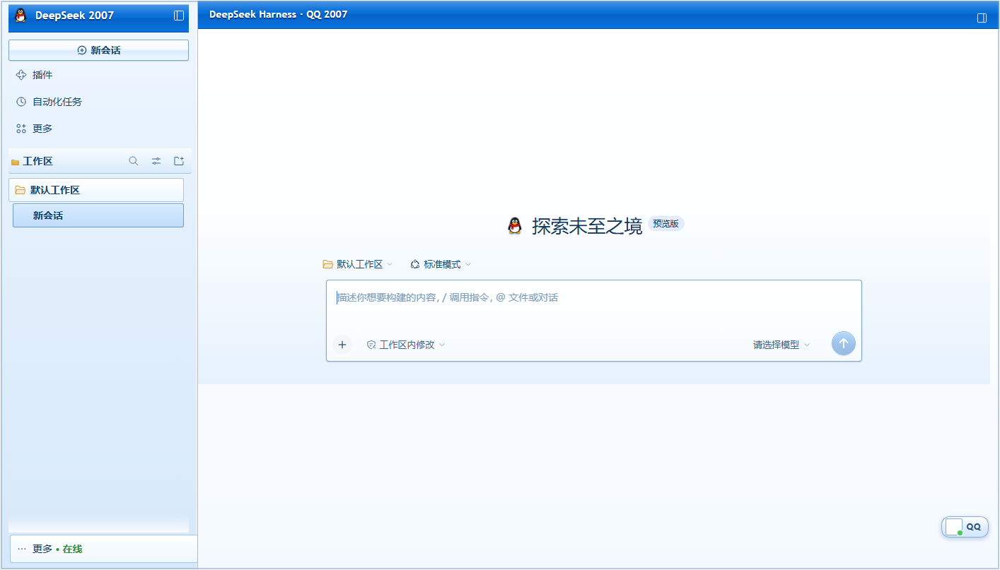
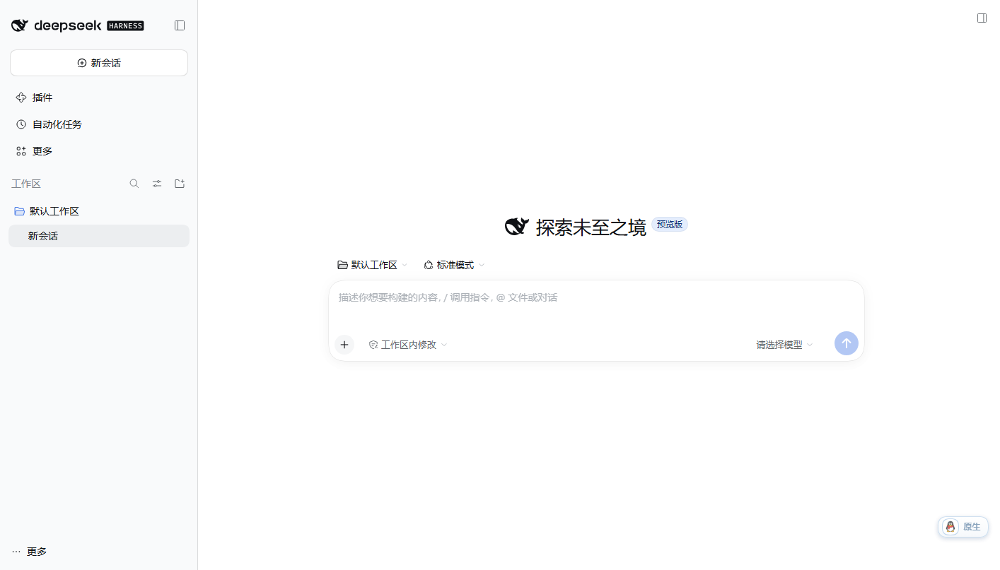
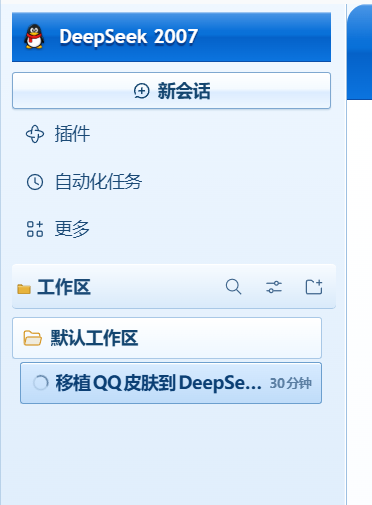

# dsh-skin-qq2007 · 经典 QQ 2007 皮肤（DeepSeek Harness）

把 [zhulin025/Codex-QQ-Skin](https://github.com/zhulin025/Codex-QQ-Skin) 的 **经典 QQ 2007 蓝银外观** 移植到当前 DeepSeek Harness 桌面端 / Web 客户端。

它是 Harness 的一个本地客户端插件（host 半 + browser bundle + 一个全局样式表），不是 DSP 补丁，也不改写 `app.asar`：皮肤 = `body[data-dsh-qq-skin]` 一个属性 + 一张样式表 + 右下角一个企鹅开关。

| QQ 皮肤 | 一键还原原生 |
| --- | --- |
|  |  |



> 截图来自本机（未登录状态），已避开账号头像/昵称等个人信息。

## 效果

| 区域 | 移植后的样子 |
| --- | --- |
| 顶部 | 38/40px 深蓝渐变标题条（`#1979df → #0870d8 → #0562c9`），白色描边高光、文字投影；侧栏 logo 行、会话标题行、右侧面板标签条连成一条 |
| 侧栏 | QQ 蓝银渐变底、左侧 1px 立体描边；品牌区换成企鹅 + **DeepSeek 2007** 字样 |
| 按钮 / 导航 | XP 式凸起按钮（新会话、标签页、状态胶囊），悬停泛白、按下内凹 |
| 工作区 | 分组标题带黄色文件夹图标；工作区行 = 文件夹小面板；会话行选中 = 蓝底蓝框 |
| 用户卡 | 左下角白底面板 + 企鹅/头像 + 绿色在线点 + “· 在线” |
| 会话区 | 白色信纸渐变画布；用户消息是浅蓝描边气泡；标题、正文使用深蓝灰 |
| 输入区 | 白底蓝框输入卡片、蓝色渐变发送按钮、复古滚动条 |
| 右侧面板 | 蓝色标签条（白色标签 + 白色窗口按钮）、卡其白内容区 |
| 开关 | 右下角企鹅胶囊：`QQ` / `原生` 一键切换，`localStorage` 记住选择 |

深色主题下也会强制使用这套浅色蓝银外观（QQ 2007 没有暗色模式）。

## 目录

```
dsh-skin-qq2007/
├─ package.json          # dsh.client 声明：platform web, immediately
├─ lib/index.js          # host 半：无服务、无模型贡献
├─ lib/client.js         # 已构建的浏览器 bundle（内联样式表 + 企鹅 data URI）
├─ src/client.js         # bundle 源码模板
├─ src/qq2007.css        # 皮肤样式表（作者源）
├─ build.mjs             # 把 CSS / 头像内联进 lib/client.js
├─ assets/qq-avatar.png  # 上游 Codex-QQ-Skin 的企鹅素材
├─ install.ps1           # 安装到 profile
├─ uninstall.ps1         # 卸载并还原
└─ tests/qq-skin.test.mjs# CDP 端到端测试（23 条断言）
```

## 安装

要求：DeepSeek Harness Desktop（0.2.1-rc.3，Windows），并且 `%USERPROFILE%\.dsh\profiles\desktop` 是当前使用的 profile。

```powershell
# 在本目录执行
powershell -ExecutionPolicy Bypass -File .\install.ps1
```

脚本会：

1. 把包复制到 `%USERPROFILE%\.dsh\profiles\desktop\node_modules\dsh-skin-qq2007`；
2. 在 `cordis.patch.yml` 末尾追加一条 loader 插入行：

```yaml
- insert:
    - id: skin-qq2007
      name: dsh-skin-qq2007
```

Harness 的 Loader 会热加载这条新行，客户端模块图通过 IPC/HMR 推给已打开的窗口，**通常无需重启**（本机实测即时生效）。若没有立即生效，重启一次 DeepSeek Harness 即可。

> 皮肤以“原始 loader 行”形式安装，因此不会出现在「插件」页的 bundle 清单里（那里列出的是 bundle 与依赖）。开关请用桌面右下角的企鹅胶囊，卸载用 `uninstall.ps1`。

## 使用

- 右下角胶囊显示 `QQ` = 皮肤开启；点一下切到 `原生`，界面立即还原为官方外观。
- 选择写入 `localStorage["dsh-skin-qq2007.mode"]`，刷新、重启后保持。
- 原生模式下胶囊仍在（显示 `原生`），用于切回皮肤。

## 卸载

```powershell
powershell -ExecutionPolicy Bypass -File .\uninstall.ps1
```

删除 profile 中的包目录与 `cordis.patch.yml` 里的 `skin-qq2007` 插入块，窗口恢复原生外观（如未恢复，刷新/重启一次）。

## 开发

```powershell
# 重新生成 lib/client.js（样式表或头像变更后）
node build.mjs        # 任意 Node 20+；本机可用 Harness 自带的 Electron-as-Node
```

`build.mjs` 做三件事：把 `src/qq2007.css` 里的 `__QQ_AVATAR_URL__` 换成本地 data URI，把 CSS 与头像以 JSON 字符串注入 `src/client.js`，并给所有 `body[data-dsh-qq-skin]` 选择器再加一个属性，让皮肤规则稳定压过 Harness 组件样式（组件常用两三个类名，例如 `.root[data-phase] .seat`）。

## 测试

`tests/qq-skin.test.mjs` 通过 CDP 驱动真实浏览器，断言 23 项：

- 插件注入：样式标签、开关按钮、默认开启、标签文案；
- 2007 配色：标题条蓝色渐变、侧栏渐变、输入卡 1px 蓝框、信纸画布；
- 复古装饰：`DeepSeek 2007` 文案、企鹅 data URI、`· 在线` 后缀；
- 布局安全：无横向溢出、frame 与视口同尺寸；
- 模式往返：切原生 → 渐变消失、品牌恢复、写 storage → 刷新仍为原生 → 切回 QQ → 刷新仍为 QQ、样式重新注入；
- 运行期无来自皮肤的 console error。

运行方式（需要先起一个带 token 的 Web 端并在 headless Chromium 上开 CDP）：

```powershell
# 1) 启动测试用 web profile（独立 DSH_HOME，端口 51888）
dsh --profile web --no-open --port 51888

# 2) 无头 Edge 打开带 token 的地址并开 9333 调试端口
msedge --headless=new --remote-debugging-port=9333 --user-data-dir=%TEMP%\qq-skin-cdp "<tokenized url>"

# 3) 跑测试（用 Harness 自带 Electron 当 Node 也可以）
node tests/qq-skin.test.mjs --port 9333 --url "<tokenized url>" --out test-results
```

本机最近一次结果：**23 passed, 0 failed**，见 [`test-results/report.json`](test-results/report.json)。测试截图（含本机账号信息）不随仓库发布。

## 与上游的差异

上游是给 Codex 桌面端做 **CDP 注入** 的独立程序，选择器全部针对 Codex 的 DOM（`html.codex-qq-skin`、`--ds-*` token、`app-shell-*`）。DSH 的 DOM 和 token 体系（`--dsw-*`、`[data-slot]`、CSS Modules 类名）完全不同，所以这里不是拷 CSS，而是按同一套视觉语言重写：

- 保留：蓝银渐变、双层标题区、XP 按钮、蓝框卡片、企鹅形象与在线状态、深蓝白字标题；
- 用 DSH 的 `--dsw-alias-*` token 统一改色，再对 `[data-slot]` / `data-*` / 类名子串做定点增强；
- 未移植：QQ 等级/token 统计、伙伴房间、提示音、图片自定义皮肤、Codex 专用三栏强制布局（DSH 本身已是三栏 + 可开右侧面板）。

Windows 原生标题栏（`应用 / 编辑` 菜单与最小化/最大化/关闭按钮）由系统绘制，皮肤不去覆盖它；蓝色标题条紧贴在它下方。

## 素材与许可

- **代码**：[MIT](LICENSE)。
- **来源**：移植自 [zhulin025/Codex-QQ-Skin](https://github.com/zhulin025/Codex-QQ-Skin)（MIT，© 2026 Codex QQ Skin contributors），其许可全文见 [LICENSES/Codex-QQ-Skin-MIT.txt](LICENSES/Codex-QQ-Skin-MIT.txt)；对方的 NOTICE 也已在本仓库 [NOTICE.md](NOTICE.md) 中延续。
- **素材**：`assets/qq-avatar.png` 取自上游仓库，按其说明是 AI 生成的非官方复古企鹅，不代表腾讯/QQ 官方素材。MIT 只覆盖代码，不授予腾讯、QQ、DeepSeek、OpenAI 的商标或外观权利；任何商业分发前请自行完成商标与素材审查。
- **关联声明**：本项目与腾讯、QQ、DeepSeek、OpenAI 均无关联，也不分发 DeepSeek Harness 本体或其 `app.asar`。

### 发布到 GitHub 前的检查清单

- [x] `LICENSE`（MIT）+ 上游 MIT 全文 + `NOTICE.md`（归属、商标、素材、非官方声明）
- [x] 仓库内不含账号头像 / 昵称 / token / 本机绝对路径（截图取未登录状态，仅保留侧栏与主区）
- [x] 不含 DeepSeek Harness 本体、`app.asar` 或任何官方素材
- [x] 测试报告已去掉本地 token 化 URL
- [x] `lib/client.js` 是构建产物：发布时一并提交，并在 README 里说明 `build.mjs` 可重建
- [ ] 若要更稳妥，可把仓库名改成中性名字（如 `dsh-retro-im-skin`），在简介里写 “classic QQ 2007-inspired”，把 `QQ` 仅作为风格描述使用

